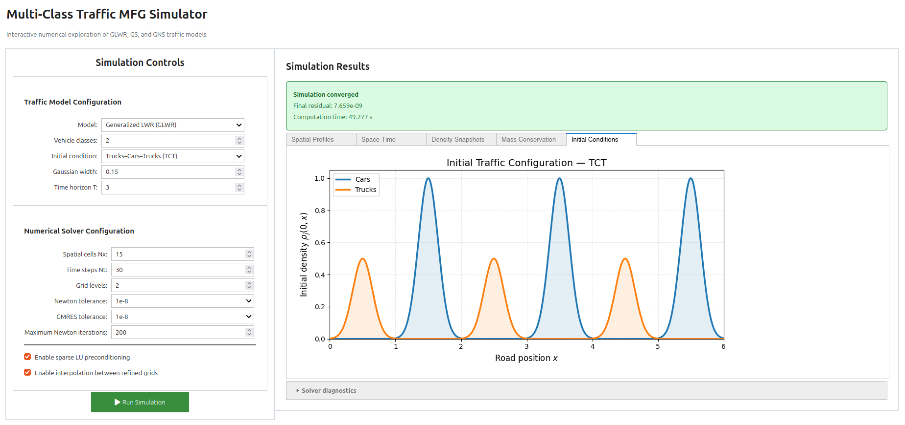

<div align="center">

# Multi-Class Traffic Flow Modeling with Mean-Field Games

Numerical methods and implementations for multi-class traffic flow models based on Nash Mean-Field Games (NMFGs).

This repository accompanies research on game-theoretic traffic modeling with heterogeneous vehicle populations, including cars and trucks. The investigations address macroscopic mean-field dynamics, microscopic finite-player games, and the approximation of Nash equilibria using mean-field controls.


<br>

[](https://doi.org/10.1016/j.trb.2025.103196)
[](https://arxiv.org/abs/2306.13543)
[](https://theses.hal.science/tel-05806256/document)
<br>

[](https://github.com/amalmach/MultiClass-MFG-Traffic/actions/workflows/numerical-tests.yml)
[](https://github.com/amalmach/MultiClass-MFG-Traffic/actions/workflows/petsc-tests.yml)
<br>

</div>

---

## Interactive Traffic MFG Simulator

Explore multi-class traffic Mean-Field Games through an interactive
numerical simulator.

Select the traffic model (GLWR, GS, or GNS), vehicle classes, initial
density configuration, and numerical parameters. Run simulations and
visualize traffic density, velocity, flux, value functions, and
mass conservation.

[](https://mybinder.org/v2/gh/amalmach/MultiClass-MFG-Traffic/main?urlpath=voila%2Frender%2Fnotebooks%2Finteractive_multi_class_demo.ipynb)



The simulator runs in the browser using Binder and Voilà.
No local installation is required.

The [Jupyter notebook](notebooks/interactive_multi_class_demo.ipynb)
is also available for users who wish to inspect or modify the Python code.

> **Computational resources:** Binder provides limited CPU and memory resources.
> Large spatial or temporal grids and multiple refinement levels may
> require substantial computation time or exceed the available memory.
> We recommend starting with small grids and increasing the resolution
> progressively. For large-scale experiments, run the solver locally
> or on an HPC system.

---

### 📈 [Explore the Scientific Figures & Numerical Results Gallery](results/figures/README.md)

### 💻 [Explore the Source Code & Numerical Implementations](src/README.md)


---
## Mathematical Models

The macroscopic formulation describes the interactions of heterogeneous vehicle populations through a coupled system of continuity equations, Hamilton–Jacobi–Bellman equations, and optimal velocity conditions.

The multi-class numerical implementations support three cost formulations:

| Model | Description |
|:---|:---|
| **GLWR** | Generalized Lighthill–Whitham–Richards |
| **GS** | Generalized Separable |
| **GNS** | Generalized Non-Separable |

The framework considers class-dependent traffic densities, velocity constraints, and congestion costs.

### Initial Traffic Configurations

The numerical investigations presented in the associated research consider three spatial arrangements of cars and trucks:

| Configuration | Description |
|:---:|:---|
| **CT — Cars–Trucks** | Cars initially positioned in front of trucks |
| **TC — Trucks–Cars** | Trucks initially positioned in front of cars |
| **TCT — Trucks–Cars–Trucks** | Trucks and cars arranged in successive groups |

The simulations examine density evolution, class-dependent velocities, and interactions between vehicle populations under different initial conditions.

### Mean-Field and Microscopic Dynamics

In addition to the macroscopic PDE system, the associated research investigates finite-player traffic games and compares their dynamics with mean-field solutions.

The numerical investigations provide computational evidence for the approximation of finite-player Nash equilibria using mean-field equilibrium controls.

The published model considers single-lane traffic and does not explicitly impose microscopic collision-avoidance constraints.


---

## Quick start

The following commands should be executed from the repository root.

### Single-class example

Requires Python, NumPy, and SciPy.

```bash
python3 examples/one_class_demo/run_demo.py
```

An interactive version is available in the [single-class LWR notebook](notebooks/one_class_LWR.ipynb).

The notebook can also be opened through [Binder](https://mybinder.org/v2/gh/amalmach/MultiClass-MFG-Traffic/main?labpath=notebooks%2Fone_class_LWR.ipynb).

### Sequential multi-class solver

Requires Python, NumPy, and SciPy.

```bash
python3 src/newton_krylov/multi_class/main.py \
    --J 3 \
    --model GLWR \
    --nx 5 \
    --nt 8 \
    --max-grids 1 \
    --output sequential_J3_GLWR.npz
```

The `--model` argument accepts `GLWR`, `GS`, or `GNS`, and `--J` specifies the number of vehicle classes.

For solver parameters and numerical options, see the [Newton–Krylov documentation](src/newton_krylov/README.md).

### Parallel multi-class solver

Requires PETSc, MPI, `petsc4py`, and `mpi4py`, with MUMPS support.

The implementation uses PETSc SNES for nonlinear Newton iterations and MUMPS for sparse direct factorization.

```bash
mpirun -np 2 python3 src/petsc4py/multi_class/main.py \
    --J 3 \
    --model GLWR \
    --nx 5 \
    --nt 8 \
    --tol 1e-8 \
    --output petsc_J3_GLWR_MPI2.npz
```

The solver supports the GLWR, GS, and GNS formulations. The number of vehicle classes can be specified using `--J`.

For installation instructions and additional options, see the [PETSc/MPI documentation](src/petsc4py/README.md).

---

## Numerical Verification

The numerical implementations are verified through automated tests covering:

- Cost functions and analytical derivatives.
- Sparse Jacobian consistency.
- Conservation of vehicle density.
- Convergence of sequential and parallel solvers.
- Agreement between Newton–GMRES and PETSc/MPI solutions.
- Numerical consistency across different MPI process counts.

Run the test suite with:

```bash
python3 -m pytest tests/
```

See the [numerical testing documentation](tests/README.md) for requirements and additional information.

---

## References

### Journal Article

**A. Machtalay, A. Habbal, A. Ratnani, I. Kissami**

*Computational investigations of a multi-class traffic flow model: Mean-field and microscopic dynamics.*

**Transportation Research Part B: Methodological**, Volume 195, 103196 (2025).

[](https://doi.org/10.1016/j.trb.2025.103196)

[](https://arxiv.org/abs/2306.13543)

### PhD Thesis — 2026

**Amal Machtalay**

*Micro–macro modeling and scalable numerical methods for high-dimensional mean-field and control systems: structure-exploiting solvers and low-rank techniques.*

**Université Côte d’Azur & Mohammed VI Polytechnic University**, 2026.

**Relevant material:** Chapter II — Multi-class traffic modeling and computational investigations and Appendix D on the numerical implementations.

[](https://theses.hal.science/tel-05806256/document)

---

## License

This repository is distributed under the [GNU General Public License, version 3](LICENSE).

The [original research-code release](https://github.com/amalmach/MultiClass-MFG-Traffic/releases/tag/v1.0.0-original) is available for reference.
