

# 📊 Scientific Figures & Numerical Results

This gallery presents numerical results from the investigation of single-class and multi-class traffic flow models based on Nash Mean-Field Games (NMFGs).

The figures illustrate macroscopic traffic dynamics, microscopic finite-player games, mean-field equilibrium approximations, and numerical solution properties.

The results are associated with the [research article](https://doi.org/10.1016/j.trb.2025.103196) and [PhD thesis](https://theses.hal.science/tel-05806256/document).

---

# 🚗 1. Initial Traffic Configurations

<strong>📌 Figure II.1 — One-Class Initial Density Distribution</strong>

 

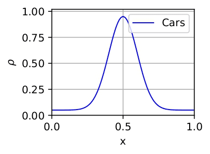

Initial density distribution for the single-class traffic model.

**Source:** PhD thesis, Figure II.1.

 

<strong>📌 Figure II.2 — Two-Class Traffic Configurations (TC, CT, TCT)</strong>

 

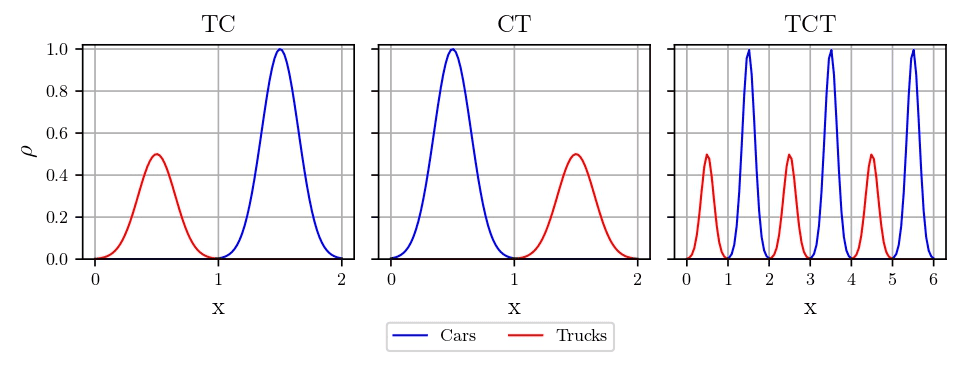

Initial density distributions for heterogeneous traffic composed of cars and trucks.

Three spatial configurations are considered:

- **TC:** Trucks–Cars.
- **CT:** Cars–Trucks.
- **TCT:** Trucks–Cars–Trucks.

These configurations are used to investigate the influence of the initial spatial arrangement on traffic dynamics.

**Sources:** PhD thesis, Figure II.2; research article, Figure 1.

---

# 🌊 2. Macroscopic Traffic Simulations

The macroscopic simulations describe the evolution of traffic density, optimal velocity, and value functions under different traffic cost formulations.

<strong>📌 Figure II.3 — One-Class Macroscopic Traffic Dynamics</strong>

 

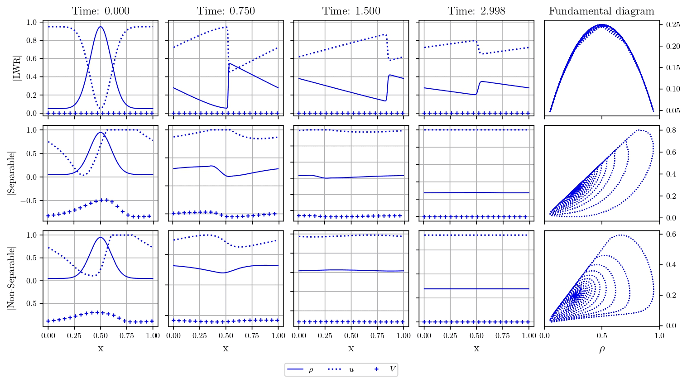

 

<b>Figure II.3.</b> Macroscopic traffic dynamics for the LWR,
Separable, and Non-Separable models.

 

Macroscopic numerical results for the single-class LWR, Separable, and Non-Separable models.

The figure compares traffic densities, optimal velocities, value functions, and fundamental diagrams.

**Sources:** PhD thesis, Figure II.3; research article, Figure 8.

 

<strong>📌 Figure II.4 — GLWR Model: Multi-Class Traffic Dynamics</strong>

 

The **Generalized Lighthill–Whitham–Richards (GLWR)** model extends
classical traffic flow modeling to heterogeneous vehicle populations.

The simulations investigate heterogeneous traffic dynamics for the
TC, CT, and TCT initial configurations.

The numerical results illustrate the evolution of:

- Class-dependent traffic densities $\rho^1, \rho^2$.
- Optimal velocity fields $u^1, u^2$.
- Optimal value functions $V^1, V^2$.
- Associated fundamental diagrams.

The corresponding fundamental diagrams provide additional information
about the relationship between traffic density and flow.

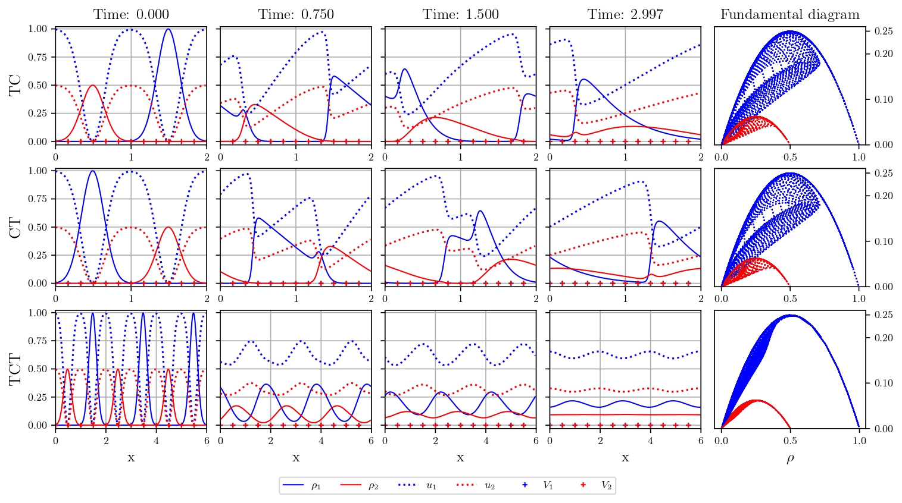

 

<b>Figure II.4.</b> Macroscopic numerical results for the GLWR model
under the TC, CT, and TCT configurations.

 

**References:** [PhD thesis, Chapter II, Figure II.4](https://theses.hal.science/tel-05806256/document) ·
[Research paper, Figure 2](https://doi.org/10.1016/j.trb.2025.103196).

 

<strong>📌 Figure II.5 — Generalized Separable (GS) Model</strong>

 

This figure presents macroscopic numerical simulations for the
**Generalized Separable (GS)** cost functional.

The simulations investigate heterogeneous traffic dynamics for the
TC, CT, and TCT initial configurations.

The numerical results illustrate the evolution of:

- Class-dependent traffic densities $\rho^1, \rho^2$.
- Optimal velocity fields $u^1, u^2$.
- Optimal value functions $V^1, V^2$.
- Associated fundamental diagrams.

These experiments demonstrate the behavior of the multi-class
mean-field model under a separable cost structure.

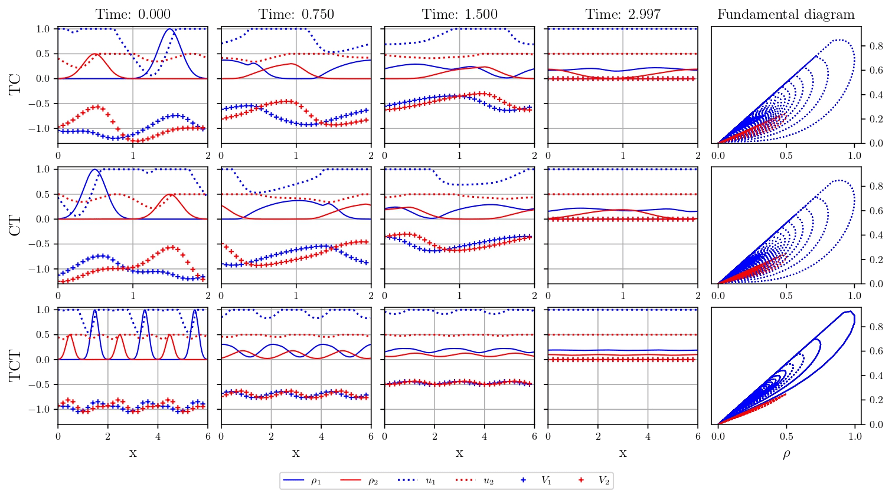

 

<b>Figure II.5.</b> Macroscopic traffic simulations under the
Generalized Separable (GS) cost functional.

 

**References:** [PhD thesis, Chapter II, Figure II.5](https://theses.hal.science/tel-05806256/document) ·
[Research paper, Figure 3](https://doi.org/10.1016/j.trb.2025.103196).

 

<strong>📌 Figure II.6 — Generalized Non-Separable (GNS) Model</strong>

 

This figure illustrates macroscopic traffic dynamics under the
**Generalized Non-Separable (GNS)** cost functional.

Unlike the separable formulation, this model incorporates a
non-separable dependence within the optimization structure.

The numerical experiments investigate the resulting traffic
dynamics for the TC, CT, and TCT configurations.

The figure presents the evolution of:

- Class-dependent traffic densities $\rho^1, \rho^2$.
- Optimal velocity fields $u^1, u^2$.
- Optimal value functions $V^1, V^2$.
- Associated fundamental diagrams.

These simulations complement the GS and GLWR experiments by
examining a different cost structure.

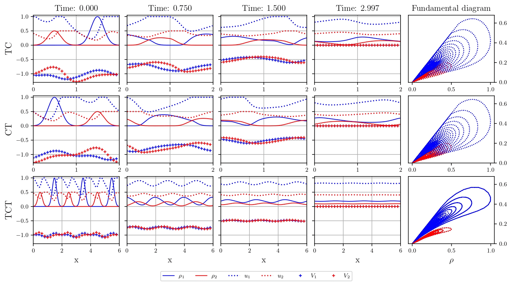

 

<b>Figure II.6.</b> Macroscopic traffic simulations under the
Generalized Non-Separable (GNS) cost functional.

 

**References:** [PhD thesis, Chapter II, Figure II.6](https://theses.hal.science/tel-05806256/document) ·
[Research paper, Figure 4](https://doi.org/10.1016/j.trb.2025.103196).

---

# 🚘 3. Microscopic Traffic Simulations

The microscopic experiments investigate finite-player traffic games
and their relationship with the corresponding macroscopic
mean-field formulations.

The comparisons provide numerical evidence concerning the
approximation of finite-player strategies by mean-field equilibria.

<strong>📌 Figure II.7 — One-Class Microscopic Strategy Comparison</strong>

 

This figure compares microscopic traffic strategies obtained from
the macroscopic mean-field formulation with finite-player
best-response strategies.

The experiments consider the single-class traffic model.

The comparisons focus on the relationship between:

- Mean-field-derived controls $\hat{v}$.
- Finite-player best-response strategies $\bar{v}$.
- Associated individual costs $J_{\hat{v}}, J_{\bar{v}}$.

These results support the numerical investigation of the
connection between mean-field equilibria and finite-player games.

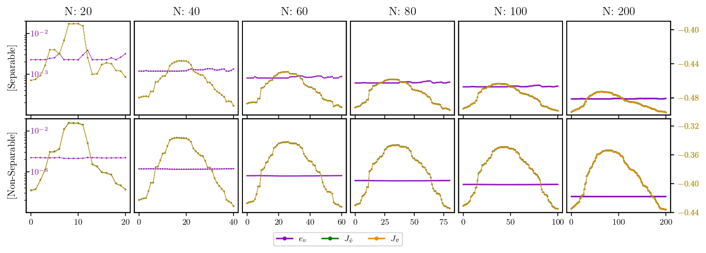

 

<b>Figure II.7.</b> Comparison between mean-field-derived
strategies and finite-player best responses for one-class traffic.

 

**References:** [PhD thesis, Chapter II, Figure II.7](https://theses.hal.science/tel-05806256/document) ·
[Research paper, Figure 9](https://doi.org/10.1016/j.trb.2025.103196).

 

<strong>📌 Figure II.9 — Two-Class Microscopic Strategy Comparison</strong>

 

This figure investigates microscopic traffic behavior for
heterogeneous populations of cars and trucks.

The experiments compare finite-player costs with the strategies
obtained from the mean-field formulation.

The analysis considers:

- Generalized Separable (GS) cost functional.
- Generalized Non-Separable (GNS) cost functional.
- TC, CT, and TCT initial traffic configurations.

The numerical comparisons help assess the relationship between
multi-class mean-field equilibria and finite-player game dynamics.

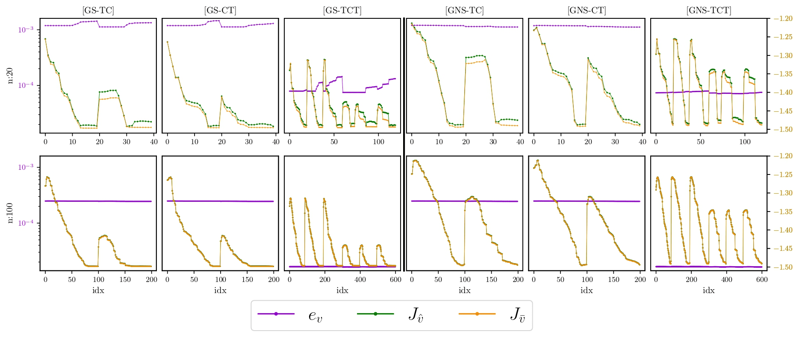

 

<b>Figure II.9.</b> Microscopic traffic comparisons for
heterogeneous two-class systems under GS and GNS cost functionals.

 

**References:** [PhD thesis, Chapter II, Figure II.9](https://theses.hal.science/tel-05806256/document) ·
[Research paper, Figure 5](https://doi.org/10.1016/j.trb.2025.103196).

 

<strong>📌 Figure II.10 — Mean-Field and Microscopic Optimal Controls</strong>

 

This figure compares the controls associated with the
macroscopic mean-field equilibrium and the microscopic
finite-player best-response formulation.

The comparison provides a numerical illustration of the
relationship between the two levels of description.

The results are relevant to understanding how macroscopic
optimal controls approximate individual strategies in
finite-player traffic games.

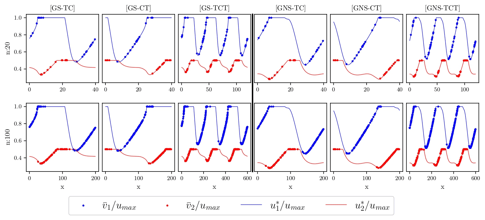

 

<b>Figure II.10.</b> Comparison of macroscopic mean-field
equilibrium controls and microscopic best-response controls.

 

**References:** [PhD thesis, Chapter II, Figure II.10](https://theses.hal.science/tel-05806256/document) ·
[Research paper, Figure 7](https://doi.org/10.1016/j.trb.2025.103196).

---

# 🎯 4. Nash Equilibrium Approximation & Convergence

The following figures investigate the numerical accuracy of
mean-field approximations in finite-player traffic games.

The analysis considers approximation errors and their behavior
as the number of players increases.

<strong>📌 Figure II.8 — One-Class Nash Approximation Accuracy</strong>

 

This figure presents numerical investigations of the approximation
accuracy for the single-class traffic game.

The analysis includes:

- Mean approximation errors: MeanRA
- Maximum approximation errors: MaxRA
- Log–log representations of numerical convergence: log(MeanRA), log(MaxRA)

These experiments help quantify how accurately mean-field-derived
strategies approximate equilibria in finite-player systems.

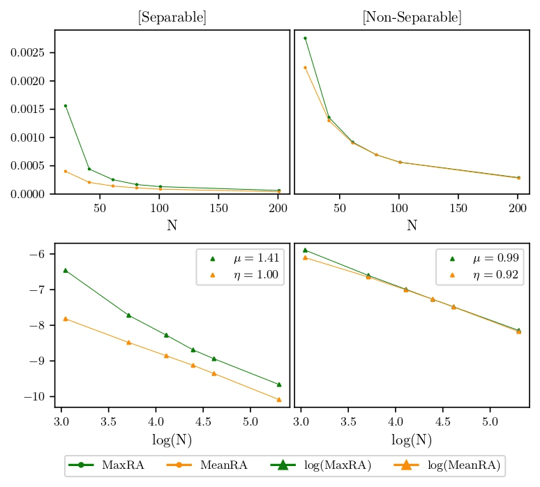

 

<b>Figure II.8.</b> Mean and maximum approximation errors
and log–log convergence analysis for one-class traffic.

 

**References:** [PhD thesis, Chapter II, Figure II.8](https://theses.hal.science/tel-05806256/document) ·
[Research paper, Figure 10](https://doi.org/10.1016/j.trb.2025.103196).

 

<strong>📌 Figure II.11 — Two-Class Nash Approximation Accuracy</strong>

 

This figure investigates mean-field approximation accuracy
for a heterogeneous finite-player traffic game.

The numerical experiments examine:

- Mean approximation errors: MeanRA
- Maximum approximation errors: MaxRA
- Log–log representations of numerical convergence: log(MeanRA), log(MaxRA)

The results provide numerical evidence about the approximation
of finite-player Nash equilibria by multi-class mean-field
equilibrium strategies.

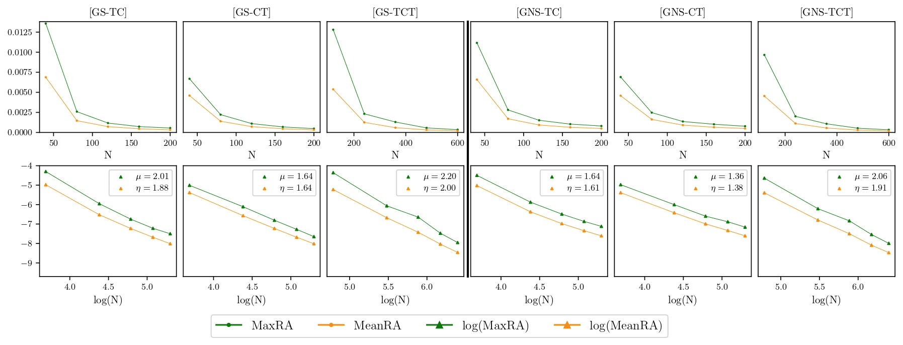

 

<b>Figure II.11.</b> Mean and maximum approximation errors
and log–log convergence analysis for heterogeneous two-class traffic.

 

**References:** [PhD thesis, Chapter II, Figure II.11](https://theses.hal.science/tel-05806256/document) ·
[Research paper, Figure 6](https://doi.org/10.1016/j.trb.2025.103196).

---

# 📉 5. Low-Rank Structure & Numerical Analysis

<strong>📌 Figure II.12 — Singular-Value Decay and Low-Rank Structure</strong>

 

This figure examines the singular-value structure of numerical
solutions associated with the single-class traffic models.

The analysis considers numerical matrices corresponding to:

- Traffic density $\rho$.
- Optimal velocity $u$.
- Optimal cost $V$.

Normalized singular-value decay is investigated across
different spatial and temporal grid resolutions and
different one-class cost functionals.

The results provide insight into the numerical structure
of the computed solutions and their potential suitability
for low-rank approximation techniques.

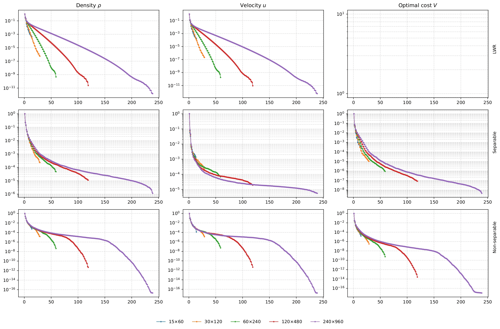

 

<b>Figure II.12.</b> Normalized singular-value decay for
density, velocity, and optimal-cost matrices.

 

**Reference:** [PhD thesis, Chapter II, Figure II.12](https://theses.hal.science/tel-05806256/document).

---

# ⚙️ Reproducibility & Numerical Experiments

The numerical figures originate from the computational investigations
presented in the associated research paper and PhD thesis.

The experiments involve macroscopic mean-field game formulations
and microscopic finite-player traffic models.

Numerical procedures investigated in the research include:

- Finite-difference discretizations.
- Forward continuity equations.
- Backward Hamilton–Jacobi–Bellman equations.
- Optimal feedback control computation.
- Nonlinear solvers and Newton–Krylov methods.
- Parallel numerical computations.

The availability of scripts, parameters, and input data may vary
between experiments. Consult the repository source code and
the associated publications for the documented computational setup.

---

# 📚 Scientific References

**Research paper**

A. Machtalay, A. Habbal, A. Ratnani, and I. Kissami,
*Computational investigations of a multi-class traffic flow model:
mean-field and microscopic dynamics*,
Transportation Research Part B: Methodological, 195 (2025), 103196.

📄 [Journal publication](https://doi.org/10.1016/j.trb.2025.103196) ·
[arXiv preprint](https://arxiv.org/abs/2306.13543)

**PhD thesis**

A. Machtalay,
*Micro–macro modeling and scalable numerical methods for high-dimensional
mean-field and control systems: structure-exploiting solvers and low-rank techniques*,
2026.

📖 [Read the PhD thesis](https://theses.hal.science/tel-05806256/document)

---

[⬅ Back to Main Repository](../../README.md)

Scientific figures from the numerical investigation of multi-class traffic flow models.

